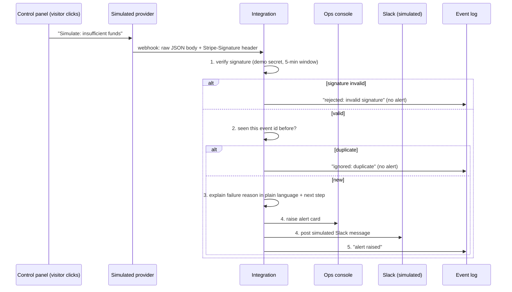

# PLAN: Kiezkaffee payment-failure alerts (customer proof of concept kit)

> **Kiezkaffee is a fictional company.** The payment provider in this project is
> **simulated**. Nothing connects to Stripe or any real service. There are no accounts,
> no API keys and no real money.

Status: **approved 2026-10-14** (repo name, separate repo, plan as written).

---

## 1. Repo name

**Proposed:** `kiezkaffee-payment-alerts-poc` (public, under `GonzaSSH`)

Live demo would be: `https://gonzassh.github.io/kiezkaffee-payment-alerts-poc/`

## 2. The problem in one sentence

When a card payment fails at Kiezkaffee, nobody notices for hours and the order is lost.
The proof of concept shows the team **within a minute** what failed, **why** in plain
language, and **what to do next** to recover the order.

## 3. Where the "Stripe-like" behaviour comes from

Stripe's documentation site (docs.stripe.com) is **blocked by this build environment's
network**. Instead, everything is based on Stripe's **official public source code on
GitHub**, which describes the same behaviour as the docs:

| What we copy | Source (official Stripe repo) |
|---|---|
| Signature header format `Stripe-Signature: t=<timestamp>,v1=<signature>` | `stripe/stripe-node` → `src/Webhooks.ts` |
| Signature = HMAC-SHA256 of `"<timestamp>.<raw body>"` with the webhook secret | same file |
| Reject signatures older than **300 seconds** (replay protection) | same file (`DEFAULT_TOLERANCE: 300`) |
| Event shape: `id, object, api_version, created, data.object, livemode, pending_webhooks, request, type` | `stripe/openapi` → `spec3.json` (API version `2026-09-30`) |
| Event names `payment_intent.payment_failed`, `payment_intent.succeeded` | same spec |
| Failure reasons `last_payment_error.code` and `.decline_code` (e.g. `card_declined` + `insufficient_funds`, `expired_card`) | `stripe/stripe-go` → `error.go` |

Where we simplify (fewer fields, fake IDs like `pi_sim_...`), the README and
solution design say so. This is a **documented approximation**, not a copy of Stripe.

## 4. Event flow



A later `payment_intent.succeeded` for the same payment **resolves** the open alert
("Recovered: customer retried and paid"), so the team does not chase an order that is
already saved.

Everything runs in the visitor's browser. The simulated provider calls the
integration's `receiveWebhook(rawBody, headers)` function directly instead of over the
internet. In a real deployment that same function would sit behind an HTTPS endpoint.

## 5. The swap boundary (simulated provider ↔ real provider)

All provider-specific code lives in **one folder: `src/provider/`**. It exposes one
function to the rest of the app:

```ts
// The only thing the rest of the app knows about the payment provider:
parseVerifiedEvent(rawBody: string, headers: Record<string, string>): Promise<PaymentEvent>
```

`PaymentEvent` is our own, provider-neutral shape (payment id, order id, amount,
outcome, failure code). Duplicate checking, explanations, alerts, Slack and logging
only ever see `PaymentEvent`. Swapping to real Stripe (or Adyen, Mollie...) means
replacing what is inside `src/provider/`. Nothing else changes. The solution design
will explain this with a diagram.

## 6. Failure scenarios

| # | Scenario | What the simulated provider sends | Expected outcome (summary) |
|---|---|---|---|
| S1 | Card declined | `payment_intent.payment_failed`, `code: card_declined`, `decline_code: generic_decline` | Alert: "The bank declined the card." Next step: ask for another card or payment method |
| S2 | Insufficient funds | `card_declined` / `insufficient_funds` | Alert: "Not enough money on the card." Next step: email a pay-later link / suggest another card |
| S3 | Expired card | `code: expired_card` | Alert: "The card has expired." Next step: ask the customer to update card details |
| S4 | Fails, then succeeds on retry | `payment_failed` (insufficient funds), then `payment_intent.succeeded` for the same payment | Alert raised, then marked **Recovered**. Slack gets a second "recovered" message |
| S5 | Duplicate event | The same event (same `id`) delivered twice | Exactly **one** alert. Second delivery is logged as "duplicate ignored" |
| S6 | Invalid signature | Event signed with the wrong secret | **No alert.** Logged as "rejected: invalid signature" |
| S7 | Unknown failure reason | `card_declined` / `decline_code: some_code_we_dont_know` | Alert still raised (fail safe): "Unrecognised reason." Next step: check the provider dashboard, then contact the customer |

Phase 3 turns this table into exact fixtures and `scenarios/EXPECTED.md` (exact alert
text, Slack text, log lines) **before** any integration code is written.

Design rule worth calling out: **unknown reasons still alert.** Missing an alert costs
an order; an extra alert costs a few seconds of someone's time.

## 7. File structure

```
kiezkaffee-payment-alerts-poc/
├── README.md                    60-second read for a hiring manager
├── PLAN.md                      this file
├── CLAUDE.md                    short notes for the AI assistant
├── docs/
│   ├── customer-brief.md        Phase 2
│   ├── discovery-notes.md       Phase 2
│   ├── solution-design.md       Phase 2
│   ├── runbook.md               Phase 7
│   ├── objections.md            Phase 7
│   ├── demo-script.md           Phase 7
│   └── screenshot.png
├── scenarios/
│   ├── EXPECTED.md              expected outcome per scenario (written before code)
│   ├── fixtures/*.json          the raw events for S1–S7
│   └── expected.json            same expectations, machine-readable, used by tests
├── src/
│   ├── provider/                ← THE SWAP BOUNDARY (everything Stripe-shaped)
│   │   ├── simulator.ts         builds + signs Stripe-shaped webhooks (simulated)
│   │   ├── signature.ts         t=…,v1=… signing and verification (HMAC-SHA256)
│   │   └── adapter.ts           parseVerifiedEvent(): raw webhook → PaymentEvent
│   ├── core/                    provider-neutral logic
│   │   ├── types.ts             PaymentEvent, Alert, LogEntry
│   │   ├── dedupe.ts            remembers event ids already processed
│   │   ├── explain.ts           failure code → plain language + next step
│   │   ├── alerts.ts            raise / resolve alerts
│   │   ├── slack.ts             formats the simulated Slack message
│   │   ├── log.ts               append-only event log
│   │   └── integration.ts       receiveWebhook(): the 5 steps in order
│   ├── ui/                      control panel, ops console, Slack panel, log view
│   └── main.ts
├── tests/
│   ├── unit/                    Vitest: every scenario vs expected.json
│   └── e2e/                     Playwright: click each scenario, check the screen
├── index.html
└── .github/workflows/ci.yml     typecheck, lint, unit, e2e, build, deploy to Pages
```

## 8. Tech choices (mine to own, explained plainly)

- **TypeScript + Vite, no UI framework.** Small, fast, easy for a reviewer to read.
  Builds to plain static files, which is exactly what GitHub Pages serves.
- **Web Crypto (built into every browser)** for the HMAC-SHA256 signature. No crypto
  library needed.
- **No database** (out of scope). Alerts, dedupe memory and the log live in memory and
  reset on page reload. A "Reset demo" button clears them.
- **Mobile first.** One column on a phone, side-by-side panels on a laptop.

## 9. Test strategy

| Layer | Tool | What it proves |
|---|---|---|
| Type check | `tsc --noEmit` | No type errors |
| Lint | ESLint | Zero errors, zero warnings |
| Unit | Vitest | Each fixture S1–S7 produces **exactly** the alert, Slack text and log lines in `expected.json`. Plus focused tests: signature tampering, wrong secret, expired timestamp (>300 s), malformed header, dedupe |
| End-to-end | Playwright (Chromium, desktop + phone size) | Clicking each "Simulate" button shows the right alert and message; duplicates show one alert; invalid signature shows none |
| Build | `vite build` | Production bundle builds |
| Deployed check | Playwright against the live Pages URL | The real demo works, not just the local one |
| CI | GitHub Actions | All of the above on every push; deploy to Pages from `main` only when green |

Rules I follow: tests come from `scenarios/EXPECTED.md`, never the other way round.
I fix root causes, never skip or weaken a test, and I stop and ask you if a problem
survives three fix attempts.

**How "alert within 60 seconds" is shown:** each alert displays "time to alert"
(time the event was created → time the alert appeared). In the browser this is
milliseconds. The docs will be honest that real-world time depends on the provider's
delivery speed (usually seconds).

## 10. What needs you (clicks I cannot do)

1. **Enable GitHub Pages** once the repo exists: repo → **Settings** → **Pages** →
   under "Build and deployment", **Source: GitHub Actions**. (I will give you the exact
   steps at that moment.)
2. Approve this plan and the repo name.

## 11. Phases and checkpoints

| Phase | Output | I stop and wait for you? |
|---|---|---|
| 1 | PLAN.md | **Yes** |
| 2 | customer-brief, discovery-notes, solution-design | **Yes**, you rewrite parts |
| 3 | fixtures + EXPECTED.md | No (I'll show you in the report) |
| 4 | Build, test-first | No |
| 5 | QA loop until green | Only if blocked 3× |
| 6 | Independent review by a fresh subagent, fixes, re-run QA | No |
| 7 | runbook, objections, demo script, README, CLAUDE.md | Final report |

## 12. Out of scope

Real Stripe or any real service, accounts or API keys, real payments, user logins,
a database, persistent storage across page reloads, real Slack.
