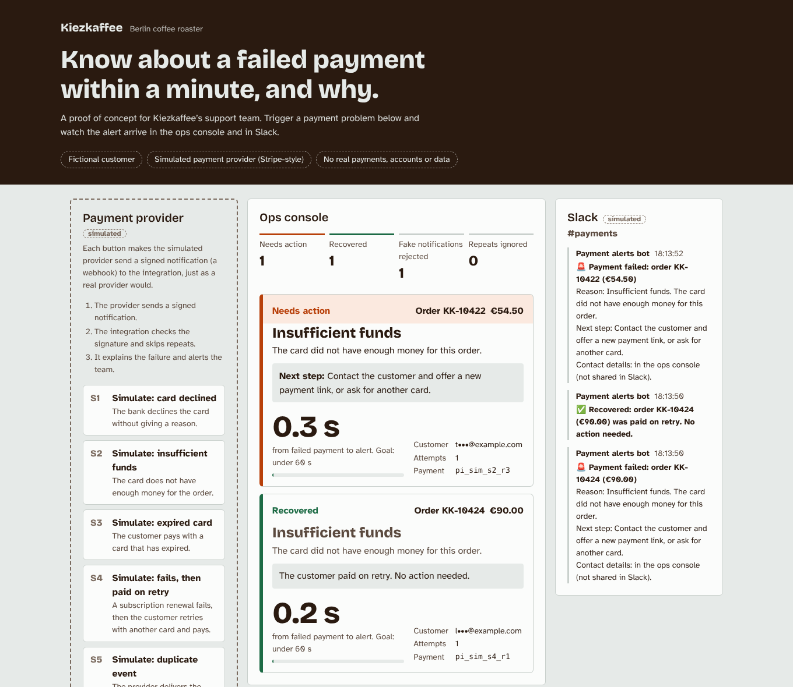

# Kiezkaffee: failed-payment alerts (customer proof of concept kit)

**▶ Live demo: https://gonzassh.github.io/kiezkaffee-payment-alerts-poc/**

> **Kiezkaffee is a fictional customer, and the payment provider is simulated.** The
> demo copies Stripe's notification format, signature scheme and failure codes, but it
> connects to nothing. No accounts, no API keys, no real money, no real data. Not
> affiliated with Stripe.

[](https://github.com/GonzaSSH/kiezkaffee-payment-alerts-poc/actions/workflows/ci.yml)

## The customer problem

Kiezkaffee, a small Berlin coffee roaster, sells online. When a card payment fails,
**nobody notices for about four hours**. By then the customer has left, and the order is
lost: about 70 orders, or roughly €2,000, a month. They want to **know within a minute,
see why, and know how to recover the order.**

## What I built

A working integration plus the documents a Solutions Engineer hands over after a
proof of concept.



- **Simulated payment provider**: sends Stripe-style signed notifications (webhooks)
  for seven scenarios, triggered from buttons.
- **The integration**:
  1. verifies each notification's signature (HMAC-SHA256, 5-minute replay window)
  2. ignores duplicates
  3. turns the failure code into plain language and a next step
  4. raises an alert in the ops console and a (simulated) Slack message
  5. logs every notification so support can trace a payment
- **No personal data in Slack.** This came from a conflict between two requirements,
  resolved in the discovery notes.
- **One swap boundary:** everything provider-specific lives in [`src/provider/`](src/provider).
  Moving to real Stripe, or another provider, means replacing one adapter.

## How it was tested

| Check | What it covers |
|---|---|
| Type check (`tsc`) and lint (ESLint, zero warnings) | The code is consistent and clean |
| Unit tests (Vitest) | Every scenario matches [`scenarios/EXPECTED.md`](scenarios/EXPECTED.md) exactly. Signatures are checked against Node's own HMAC. Also covers tampering, replay, duplicates (including simultaneous ones), out-of-order delivery and data protection |
| Do the tests catch bugs? | Seven deliberately introduced bugs (e.g. duplicate check removed, signature check removed, email leaked to Slack) were each caught |
| End-to-end (Playwright) | Every scenario clicked in a real browser, at desktop and phone size. Any page error fails the test |
| Live site | The same end-to-end tests run against the deployed GitHub Pages demo |
| CI | GitHub Actions runs all of the above on every push |

The expected outcomes were written down **before** the code, and the tests compare
against them.

## Documents

| For | Document |
|---|---|
| The plan | [PLAN.md](PLAN.md) |
| The customer and what success means, in numbers | [docs/customer-brief.md](docs/customer-brief.md) |
| Discovery call, requirements and the conflict we resolved | [docs/discovery-notes.md](docs/discovery-notes.md) |
| Architecture, the swap boundary, trade-offs | [docs/solution-design.md](docs/solution-design.md) |
| Expected outcome of every scenario | [scenarios/EXPECTED.md](scenarios/EXPECTED.md) |
| Support: "the alert didn't fire, what do I check?" | [docs/runbook.md](docs/runbook.md) |
| The CTO's questions: security, outages, GDPR, cost, scale | [docs/objections.md](docs/objections.md) |
| 5-minute demo script | [docs/demo-script.md](docs/demo-script.md) |

## Built with Claude Code

I worked with [Claude Code](https://claude.ai/code) as my engineer. The split:

| I decided | Claude Code did |
|---|---|
| The project: a proof of concept kit for an SE portfolio, with its scope and phases | Wrote the plan, the code, the tests and the CI pipeline |
| The fictional customer, their problem and the success target (alert within 60 seconds) | Drafted the customer documents for my review and edits |
| The requirements: verify signatures, ignore duplicates, plain-language reasons, ops console and Slack, a full log, one swap boundary | Researched Stripe's behaviour from its official open-source libraries (the docs site was blocked in its environment) |
| Approved the plan, repo name and documents, and edited the customer story | Ran all QA, iterated until green, and had a separate AI reviewer check the work |
| Created the repo and turned on GitHub Pages | Found and fixed gaps along the way (e.g. out-of-order notifications) |

## What I would build next

1. **Pilot with real payments**, measuring the real target: recovering ~40% of failed orders instead of ~10%.
2. **A real deployment:** a serverless endpoint with the secret in a secret store, 30-day storage, and a real Slack webhook.
3. **One-click recovery:** a "send payment link" button on each alert.
4. **Abandoned checkouts:** customers who never finished paying, not just failed payments.
5. **Out-of-hours rules:** queue overnight alerts into a morning summary.

## Run it yourself

```bash
npm ci
npm run dev          # http://localhost:5173/kiezkaffee-payment-alerts-poc/
npm run check        # type check, lint, unit tests, build, end-to-end tests
```

Needs Node 20+. For the end-to-end tests, run `npx playwright install chromium` once.
