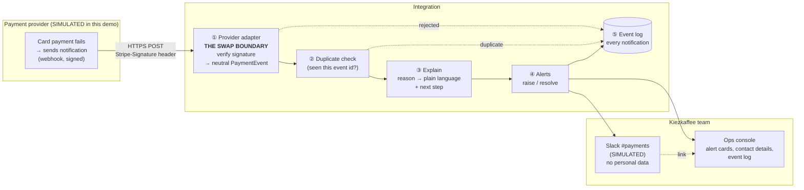

# Solution design: failed-payment alerts for Kiezkaffee

> **Fictional customer, simulated payment provider.** The demo runs entirely in the
> browser. No real payment provider, Slack workspace or customer data is involved.

## How the parts talk to each other

**In one sentence:** the provider tells the integration that a payment failed. The
integration checks the notification is genuine and new, translates the reason into
plain language, and alerts the team in Slack and the ops console. It logs every step.

## The swap boundary

Everything that knows about the payment provider sits in **one place**, the provider
adapter (`src/provider/`). It does two jobs:

1. **Checks the notification is genuine.** It recalculates the signature with the shared
   secret and rejects anything that doesn't match or is older than 5 minutes.
2. **Translates the provider's format into our own neutral `PaymentEvent`** (payment id,
   order number, amount, outcome, failure code).

Everything after the boundary (duplicate check, explanations, alerts, Slack, log) only
understands `PaymentEvent`. **To move to another provider, Kiezkaffee writes a new
adapter. The rest stays untouched.** This answers R11 ("our bank keeps offering us a
deal"). In the demo, the simulated provider sits on the same side of the boundary as
the adapter, so swapping it for the real one is the same, single change.

## Demo vs. real deployment

| Part | In this demo | In a real deployment |
|---|---|---|
| Payment provider | Simulator in the browser, Stripe-shaped events | The real provider's webhooks |
| Integration | Runs in the browser | A small serverless function (Kiezkaffee already has one) |
| Signing secret | A demo value, visible in the code on purpose | Kept in the platform's secret store, never in the browser |
| Ops console | A page in the demo | The same page behind the shop's admin login |
| Slack | A simulated message drawn on screen | Slack incoming webhook to `#payments` |
| Event log | In memory, cleared on reload | Stored for 30 days, then deleted (R13) |

## Trade-offs

| Decision | Why | What we give up |
|---|---|---|
| **Unknown failure reasons still alert** (fail safe) | A missed failure costs an order. An extra alert costs seconds (R6). | Occasionally an alert with a generic explanation |
| **Order number in Slack, contact details in the console** | Actionable *and* no personal data in Slack (R9 vs R10, see discovery notes) | One extra click per alert |
| **Alert immediately, auto-resolve on a successful retry** | Meets the 60-second target. The "recovered" update stops anyone chasing a saved order (R7). | A short-lived alert when a customer retries straight away |
| **Duplicate check by the provider's event id** | Providers deliver "at least once", so repeats are normal | Needs a short memory of seen ids (in production: same 30 days as the log) |
| **Whole demo in the browser** | Anyone can try it from a link, no servers to run | The signing secret is visible. Acceptable only because it is a demo value. |

## Assumptions

- The provider sends a signed notification for each failed and each successful payment,
  usually within seconds. **The 60-second target depends on this.**
- Each payment carries the shop's order number (in Stripe-style payments: `metadata`).
- Support works the hours in the discovery notes. Out-of-hours alerts wait in the
  console.
- Event format, signature scheme and failure codes follow Stripe's public behaviour. They
  are taken from Stripe's official open-source libraries and API specification
  (`stripe-node`, `stripe-go`, `stripe/openapi`), because the documentation site was
  not reachable from the build environment. The simulator is a documented
  approximation, not a copy of Stripe.

## Out of scope

Real payment providers, accounts or API keys, real money, real Slack, user logins,
a database or anything stored after the page closes, automatic emails to customers,
retrying the payment on the customer's behalf, refunds, and out-of-hours paging.
